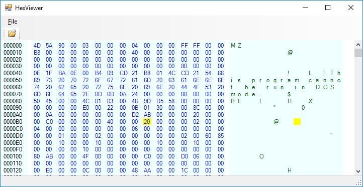

HexViewer Sample
================

A simple application to open and display a file (document) as a hexadecimal 
byte array, illustrated below.

The sample illustrates how to use some features of Kajabity.DocForms module including the following:
-	Use of ``SingleDocumentForm`` base class to provide file handling features.
-	Open a file.
-	Recent file handling.
-   Drag and Drop files.
-	Extending the ``Document`` and ``SingleDocumentManager`` base classes to implement ``BinaryDocument`` and ``BinaryDocumentManager`` classes.

The display is implemented using the ``HexPanel`` UserControl which extends Panel and draws the hexadecimal and character bytes using double buffering.  Mouse tracking is used to highlight individual hex and character bytes as the mouse moves over the panel.  Unused menu and toolbar items have been hidden - perhaps to be implemented later.

Window placement is restored through KDF's opt-in `WindowPlacementManager`.
HexViewer stores its own XML settings under
`%LOCALAPPDATA%\Kajabity\HexViewer\window-placement.xml`. Deleting this file
restores normal Windows placement. The settings are written after a successful
window close; corrupt or unavailable settings are ignored. No KDF persistence
service or application-wide settings framework is required.

To check the behaviour manually, move and resize HexViewer on a secondary
monitor, close and reopen it, then repeat while maximised. Minimise it before
closing and confirm it does not reopen minimised. Disconnect the monitor and
reopen to confirm a visible fallback on the primary working area; reconnect it
and reopen with the original settings to check preferred-monitor recovery.
Repeat after changing resolution, taskbar position and per-monitor scaling,
including a display to the left or above the primary. Also check that Windows
can move an open form during display changes without the manager fighting it.

More information is available at [http://www.kajabity.com/kajabity-tools/](http://www.kajabity.com/kajabity-tools/).
