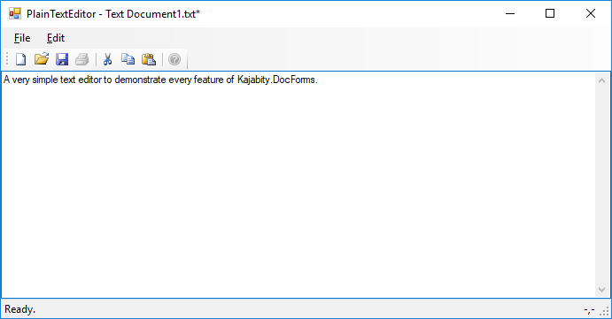

PlainTextEditor Sample
======================

This simple text editor application is intended to demonstrate every feature of Kajabity.DocForms.

All of the application and file handling features are implemented using Kajabity.DocForms.  The text editor itself is based on a TextBox control with some methods linked to standard menu items and toolbar buttons.

_Note: the sample marks the document modified when text changes. Undoing text does not automatically clear that status; saving or closing the document does._

More information is available at [http://www.kajabity.com/kajabity-tools/](http://www.kajabity.com/kajabity-tools/).
